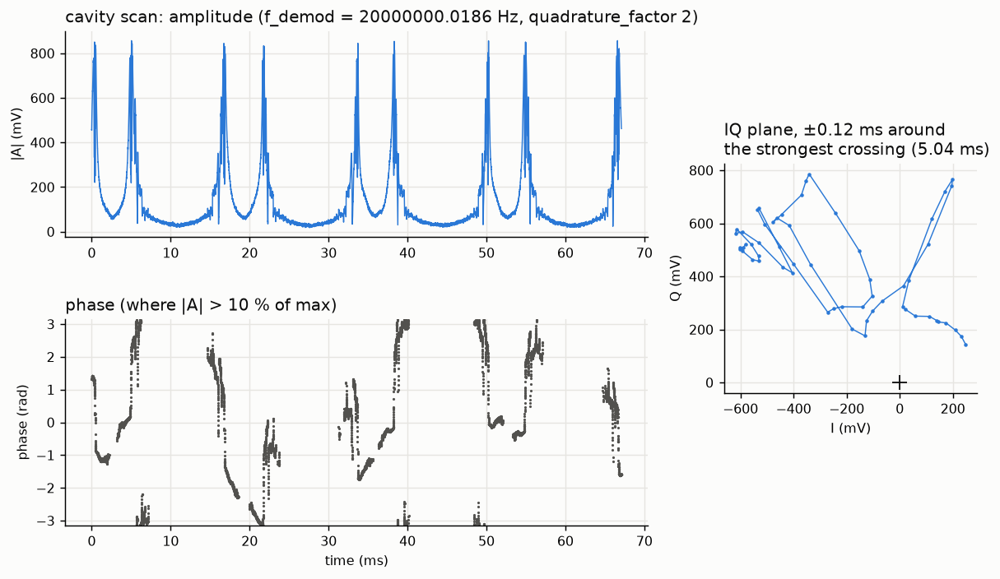

# pyrpl_extclk — real-time IQ demodulation with PyRPL and an external 125 MHz clock

This is the simple alternative to the HLS design in the rest of this repository. The Red Pitaya runs on an external
125 MHz clock derived from the lab reference, so its own NCO is phase-coherent with the lab DDS. The stock
PyRPL `iq2` module then demodulates IN1 at 20 MHz. No FPGA development is needed.

```
IN1 (20 MHz beat) ── iq2 (NCO 20 000 000.0186 Hz, 2-pole low-pass ~78 kHz) ── I, Q ── scope ── PC
                                                                              └── OUT1 = I, OUT2 = Q (real time)
IN2 (TTL gate, HV jumper) ── trig module ── scope trigger + gate length
```

## Hardware

| Item | Setting |
|---|---|
| Board | STEMlab 125-14 Pro Gen 2, Red Pitaya OS 2.07 |
| External clock | Click Shield, CLK IN+ ← 125 MHz (here: 200 MHz-sysclk AD9959 at 75 MHz, its 125 MHz image through a band-pass, about +3.6 dBm). J4/J5 removed, J1 fitted, CLK OSC off, Clock Select EXT |
| Power-up order | Apply the 125 MHz clock first, then boot the RP. If the clock drops, reboot the RP |
| IN1 | LV jumper (±1 V). Keep the signal below about 0.5 V peak, use an attenuator if needed |
| IN2 | HV jumper (±20 V) for a 3.3 V TTL gate |
| Network | Ethernet, or an Edimax EW-7811Un V2 WiFi dongle (driver `r8188eu` is built in, 2.4 GHz only) |

## WiFi dongle (once, over Ethernet)

```bash
rw
cp r8188eu.conf /etc/modprobe.d/                     # channels 1-11, no power saving
wpa_passphrase "SSID" > /opt/redpitaya/wpa_supplicant.conf
sed -i '/#psk=/d; 1i ctrl_interface=/run/wpa_supplicant\nap_scan=1' /opt/redpitaya/wpa_supplicant.conf
cp 10-wlan0-static.network /etc/systemd/network/     # optional fixed IP, edit the address first
reboot
```

The files are in `rp_config/`. Do not use the web Network Manager if the SSID contains a space. WiFi gives
about 1 MB/s. Use Ethernet for data taking.

## PC

PyRPL 0.9.x, PyQt5, pyqtgraph, numpy, paramiko. The scripts log in with the SSH key `~/.ssh/id_ed25519`, so
copy its public key to `/root/.ssh/authorized_keys` on the RP. Only one PyRPL connection at a time: each
connection re-flashes the FPGA.

| Script | What it does |
|---|---|
| `iq_gate_gui.py` | GUI: amplitude, phase, I/Q versus time. Continuous mode, or trigger mode (trace starts at the IN2 rising edge, the gate length is measured). "Save last trace" writes `iq_gate_data/iq_<time>.npz` |
| `launch_gui.py HOST [continuous\|trigger] [qf] [window_s]` | Opens the GUI, connects and starts. Trigger mode also saves every gate |
| `record_windows.py HOST n_long n_short [qf] [long_window_s]` | Records back-to-back windows to `iq_gate_data/rec_<time>.npz` |
| `iq_demod_headless.py` | Configures I → OUT1, Q → OUT2 once and exits; the FPGA keeps running |

The demodulation frequency is 687194768 · 125 MHz / 2³² = 20 000 000.0186 Hz, which matches the AD9959
FTW `0x1999999A` at 200 MHz sysclk. I/Q are in PyRPL units: `quadrature_factor` scales them, and they
saturate at 1 V.

## Example: cavity scan

`example_scan/scan_20261027.npz` holds three 67 ms windows (dt 4.1 µs) and three 33.6 ms windows
(dt 2.05 µs) of the probe transmission through a confocal cavity whose length is scanned at 60 Hz.
`python example_scan/plot_scan.py` draws:


